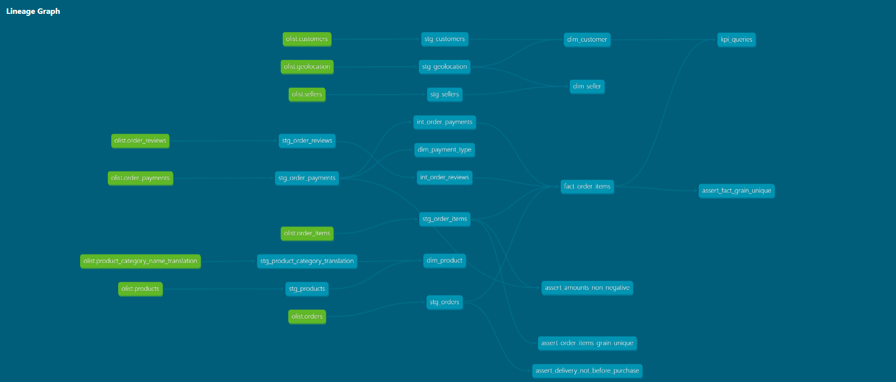

# Piloter une place de marché e-commerce (Olist) : projet BI avec dbt
 
Projet de fin de module BI, Master IA 2026, Faculté des Sciences, Université Cadi Ayyad (Marrakech).
Enseignante : Jihad ZAHIR.
 
## Équipe
 
| Membre | Contribution |
|---|---|
| **Asmae AIT BILFAKIH** | Pipeline de données : installation et chargement des données (`load_raw.py`), modèles staging (`stg_customers`, `stg_sellers`, `stg_products`, `stg_geolocation`), seed état → région (IBGE), `int_order_reviews`, table de faits `fact_order_items`, `dim_customer`, `dim_seller`, test métier, documentation dbt (lineage), connexion DuckDB et requêtes SQL des KPI, mise à jour du README |
| **Asma AZIZI** | Modélisation et restitution : modèles staging (`stg_order_items`, `stg_order_payments`, `stg_order_reviews`, `stg_product_category_translation`), seed jours fériés et événements commerciaux, `int_order_payments`, `dim_date`, `dim_product`, `dim_payment_type`, tests `relationships`, tableau de bord (pages ventes, logistique, satisfaction, vendeurs), document du livrable 2 (KPI et schéma en étoile) |
| **Ensemble** | Cadrage et choix de l'outil de restitution, parcours narratif du tableau de bord, support de présentation, soutenance |
 
## Problématique
 
Comment la direction d'Olist peut-elle piloter ses ventes (catégories, régions), sa logistique (délais, retards) et la satisfaction de ses clients (notes), et identifier les vendeurs et les zones à améliorer ?
 
**Public cible** : direction générale, responsable logistique, responsable des vendeurs.
 
## Données
 
- **Source principale** : Brazilian E-Commerce Public Dataset by Olist (Kaggle), environ 100 000 commandes entre 2016 et 2018.
- **Licence** : CC BY-NC-SA 4.0 (usage non commercial, attribution, partage dans les mêmes conditions).
- **Anonymisation** : les données sont anonymisées. Aucune tentative de ré-identification des clients ou des vendeurs n'est faite.
- Les CSV ne sont pas versionnés dans ce dépôt (dossier `data/` ignoré par Git). Il faut les télécharger depuis Kaggle.
- **Enrichissements (seeds dbt)** : correspondance état brésilien → région (IBGE, `ref_state_region`) et jours fériés / événements commerciaux brésiliens (`ref_holidays_events`). La source, la licence, la date de récupération et les transformations sont indiquées dans `olist_dbt/seeds/` (fichiers `README_*.md`).
## Stack technique
 
| Rôle | Outil |
|---|---|
| Entrepôt de données | DuckDB (fichier local `olist.duckdb`) |
| Transformation (T) | dbt-core 1.12 avec l'adaptateur dbt-duckdb |
| Chargement (E et L) | Script Python `load_raw.py` |
| Restitution | À confirmer : outil du tableau de bord (Power BI, Metabase, Looker Studio...) |
| Versionnement | Git / GitHub |
 
## Architecture ELT
 
```
CSV Olist (data/)
      │  load_raw.py  (E et L)
      ▼
DuckDB : schéma raw        ← sources dbt (olist.*)
      │  dbt
      ▼
staging       nettoyage et typage          (stg_*)
intermediate  règles métier                (int_* : paiements et avis consolidés par commande)
marts         schéma en étoile             (fact_order_items, dim_*)
      │
      ▼
Tableau de bord
```
 
Lineage dbt (graphe de dépendances généré par `dbt docs`) :
 

 
## Modèle dimensionnel (schéma en étoile)
 
**Table de faits** `fact_order_items` : une ligne = un article d'une commande (`order_id` + `order_item_id`).
 
**Mesures** : `price`, `freight_value`, `delivery_days`, `delay_days`, `is_late`, `review_score`, `payment_installments`.
 
**Dimensions** :
- `dim_date` : jour → mois → trimestre → année
- `dim_customer` : ville → état → région
- `dim_seller` : ville → état → région
- `dim_product` : produit → catégorie
- `dim_payment_type` : mode de paiement
## KPI
 
1. Chiffre d'affaires
2. Nombre de commandes
3. Panier moyen
4. Panier moyen par nombre d'échéances
5. Délai moyen de livraison
6. Taux de retard
7. Note moyenne des avis
8. Part d'avis négatifs
9. Taux de clients récurrents
10. Concentration des ventes par vendeur
Le détail (définition, formule, dimensions, intérêt métier) se trouve dans le document du livrable 2.
 
## Structure du dépôt
 
```
olist_bi/
├── .gitignore
├── README.md
├── load_raw.py            # Chargement des CSV dans DuckDB (schéma raw)
├── run_kpis.py            # Exécution des 10 KPI sur olist.duckdb
├── data/                  # CSV Olist (non versionnés, à télécharger)
├── docs/                  # lineage.png (capture du graphe dbt docs)
└── olist_dbt/             # Projet dbt
    ├── dbt_project.yml
    ├── profiles.yml       # Profil de connexion DuckDB
    ├── models/
    │   ├── staging/       # _sources.yml, stg_* (9 modèles)
    │   ├── intermediate/  # int_order_payments, int_order_reviews
    │   └── marts/         # fact_order_items, dim_date, dim_customer,
    │                      # dim_seller, dim_product, dim_payment_type
    ├── seeds/             # ref_state_region, ref_holidays_events (+ README de provenance)
    ├── tests/             # 4 tests métier (SQL)
    ├── analyses/          # kpi_queries.sql (les 10 KPI)
    ├── macros/
    └── snapshots/
```
 
## Reproduire le projet
 
### 1. Prérequis
- Python 3.10 ou supérieur
- Git
- Les 9 fichiers CSV Olist téléchargés depuis Kaggle
### 2. Récupérer le dépôt et les données
```bash
git clone <URL_DU_DEPOT>
cd olist_bi
mkdir -p data
# Copier les 9 fichiers .csv dans le dossier data/
```
> **Attention** : si le projet est dans un dossier synchronisé avec iCloud (Bureau, Documents), les gros fichiers peuvent être « déchargés » dans le cloud. Placez le projet dans un dossier non synchronisé.
 
### 3. Environnement Python et installation de dbt
```bash
python3 -m venv .venv
source .venv/bin/activate          # Windows : .venv\Scripts\activate
pip install dbt-core dbt-duckdb
dbt --version
```
 
### 4. Charger les CSV bruts dans DuckDB (E et L)
```bash
python load_raw.py
```
Résultat attendu (nombre de lignes par table du schéma `raw`) :
 
| Table | Lignes |
|---|---|
| raw.customers | 99 441 |
| raw.geolocation | 1 000 163 |
| raw.order_items | 112 650 |
| raw.order_payments | 103 886 |
| raw.order_reviews | 99 224 |
| raw.orders | 99 441 |
| raw.products | 32 951 |
| raw.sellers | 3 095 |
| raw.product_category_name_translation | 71 |
 
### 5. Vérifier la connexion et exécuter dbt (T)
```bash
cd olist_dbt
dbt debug --profiles-dir .         # doit afficher : All checks passed!
dbt build --profiles-dir .         # seeds + modèles + tests, dans l'ordre des dépendances
```
`dbt build` charge d'abord les seeds (régions, jours fériés), nécessaires aux dimensions `dim_customer`, `dim_seller` et `dim_date`. On peut aussi lancer les étapes séparément : `dbt seed`, `dbt run`, `dbt test` (toujours avec `--profiles-dir .`).
 
Vérification :
```bash
cd ..
python -c "import duckdb; con=duckdb.connect('olist.duckdb'); print(con.sql('select count(*) from main.stg_orders'))"
```
Résultat attendu : `99441`.
 
### 6. Documentation et lineage
```bash
cd olist_dbt
dbt docs generate --profiles-dir .
dbt docs serve --profiles-dir .    # documentation et graphe de dépendances (lineage)
```
 
### 7. Calculer les KPI
Les 10 requêtes KPI sont dans `olist_dbt/analyses/kpi_queries.sql`. Pour les exécuter directement sur DuckDB (après `dbt build`), depuis la racine du dépôt :
```bash
python run_kpis.py
```
Le script remplace `{{ ref('...') }}` par `main.<table>` et affiche le résultat de chaque KPI. On peut aussi compiler les requêtes avec `dbt compile --profiles-dir .`.
 
## Avancement
 
- [x] Livrable 1 : installation de dbt-core et DuckDB, chargement des CSV bruts, `dbt debug` et `dbt run`
- [x] Sources dbt déclarées, modèles staging des 9 tables
- [x] Livrable 2 : KPI et schéma en étoile (document PDF)
- [x] Couche intermediate (consolidation des paiements et des avis par commande)
- [x] Marts : table de faits `fact_order_items` et 5 dimensions
- [x] Seeds d'enrichissement (régions, jours fériés) avec provenance et licence
- [x] Tests dbt (unicité, non-nullité, relations, valeurs acceptées, 4 tests métier) et descriptions des colonnes
- [x] Requêtes SQL des 10 KPI (`analyses/kpi_queries.sql`)
- [x] Script d'exécution des KPI (`run_kpis.py`) et documentation du seed `ref_state_region`
- [x] Documentation dbt générée (`dbt docs`) et capture du lineage (`docs/lineage.png`)
- [ ] Tableau de bord et parcours narratif
- [ ] Support de présentation
- [ ] Soutenance
## Déclaration d'usage de l'IA générative
 
Des outils d'IA générative (Claude, Anthropic) ont été utilisés comme aide à l'installation, à la conception (KPI, schéma en étoile) et à la rédaction. Chaque élément livré est compris et peut être expliqué par les membres de l'équipe : Asmae AIT BILFAKIH et Asma AZIZI.
 
## Licences et crédits
 
- **Données** : Olist, via Kaggle, licence CC BY-NC-SA 4.0.
- **Sources externes (seeds)** :
  - `ref_state_region` : IBGE, Divisões regionais do Brasil (https://www.ibge.gov.br/geociencias/cartas-e-mapas/redes-geograficas/15778-divisoes-regionais-do-brasil.html). Aucune licence de réutilisation explicite identifiée : usage académique et non commercial, source citée. Détail dans `olist_dbt/seeds/README_ref_state_region.md`.
  - `ref_holidays_events` : calendrier officiel des jours fériés fédéraux brésiliens et dates d'événements commerciaux, compilés manuellement par l'équipe. Détail dans `olist_dbt/seeds/README_ref_holidays_events.md`.
 
